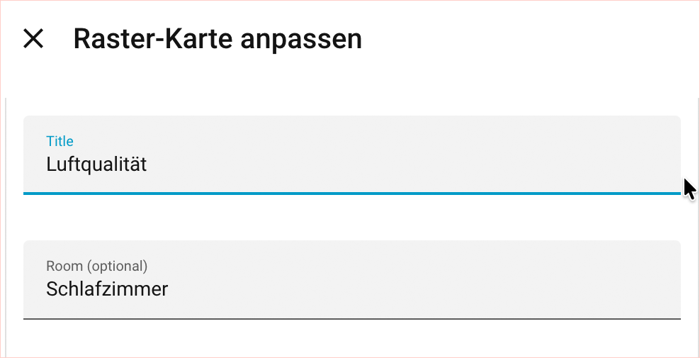
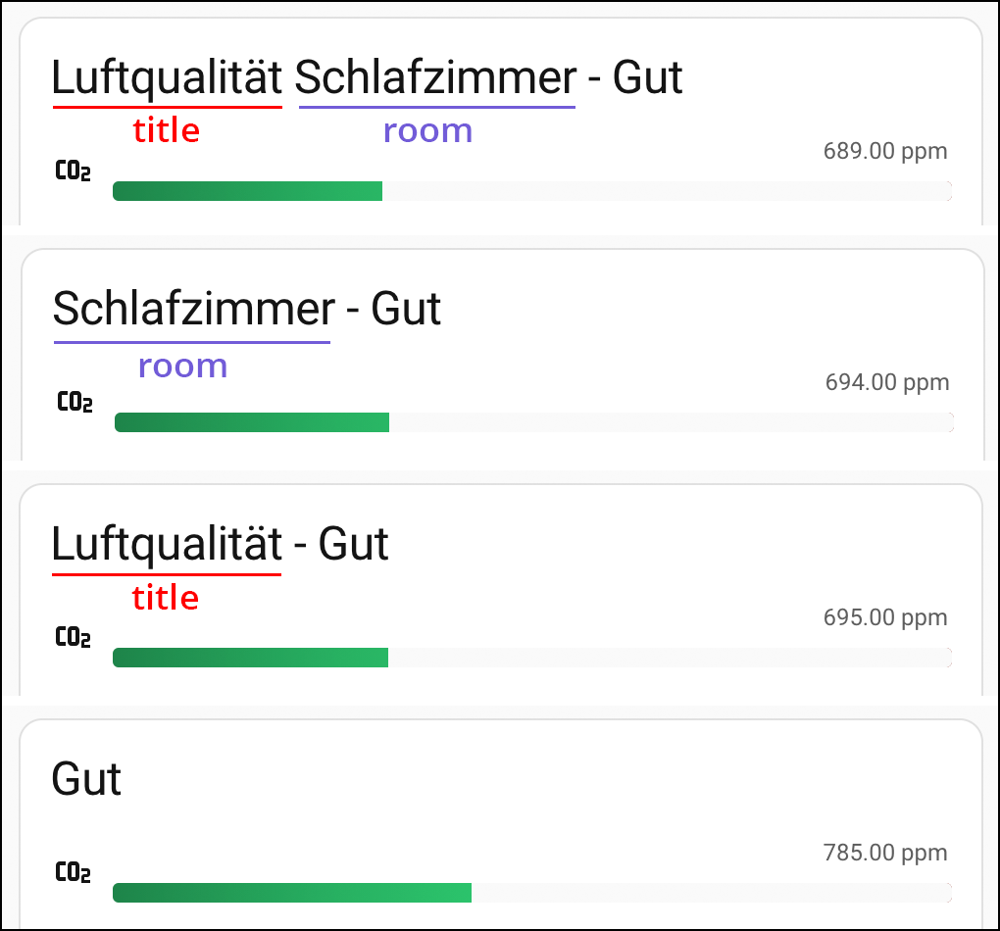
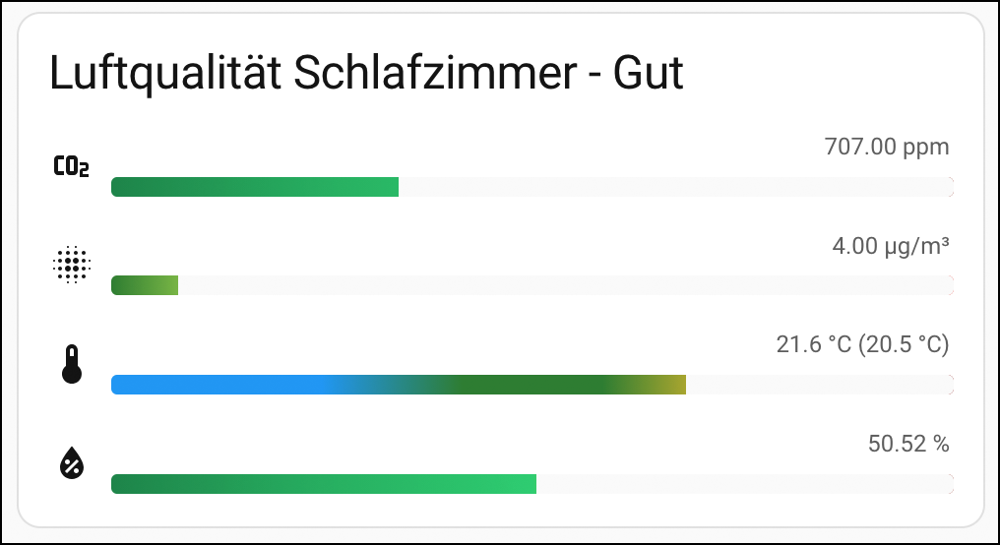
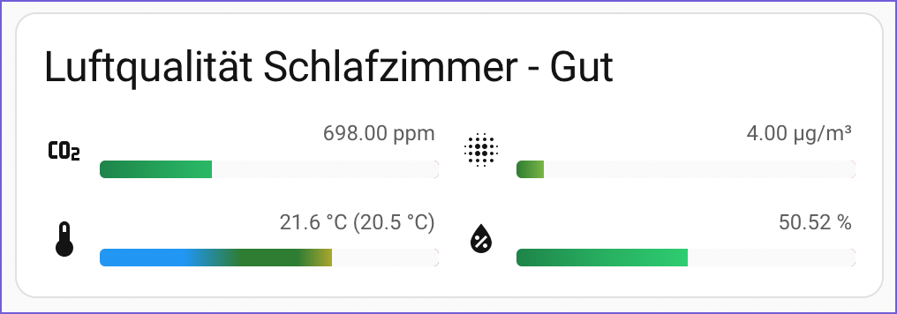
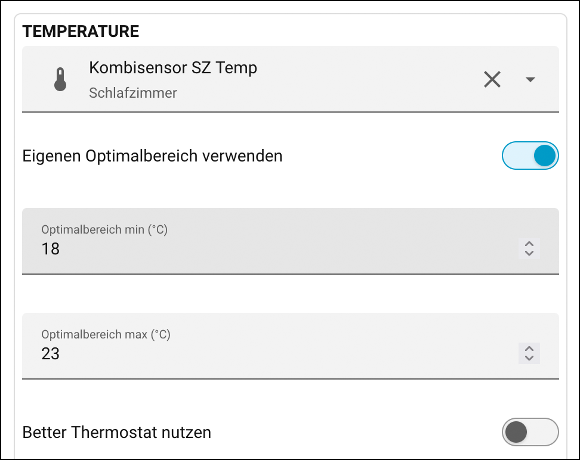

# AirQ Card

Eine benutzerdefinierte Lovelace-Karte für Home Assistant, die Luftqualitätswerte mit farbigen Balken und Optimalbereichen darstellt.

## Installation über HACS

1. Öffne in HACS **Frontend** und wähle oben rechts im Menü **Benutzerdefinierte Repositories** aus.
2. Füge die Repository-Adresse `https://github.com/mschuetze/HA-AirQ-Card` hinzu und wähle als Kategorie **Lovelace**.
3. Suche in HACS nach **AirQ Card** und installiere die Karte.
4. Füge die folgende Ressource zu deinem Dashboard hinzu:

```yaml
url: /hacsfiles/HA-AirQ-Card/airq-card.js
type: module
```

## Nutzung

Die Karte wird bevorzugt über den visuellen Editor eingerichtet. Wähle dort die gewünschten Sensoren aus und passe die Kartenfelder an.

- **Titel (`title`, optional)**
  - Legt die Überschrift der Karte fest. Das Feld kann leer bleiben.
- **Raum (`room`, optional)**
  - Ergänzt den Raumnamen neben dem Titel.



*Oberste Karte mit ausgefüllten Feldern für `Titel` und `Raum`, zweite Karte nur mit `Raum`, dritte Karte nur mit `Titel`, unterste Karte ohne beide.*

- **Anzahl der Spalten (`columns`)**
  - Legt fest, wie viele Sensor-Spalten angezeigt werden. Bleibt das Feld leer, wird die Anzahl automatisch an die Kartenbreite angepasst.


*Karte mit 1 Spalte*

*Karte mit 2 Spalten*

- **Sensor-Entitäten**
  - Wähle für jeden gewünschten Wert die passende Home-Assistant-Entität aus:
    - CO₂ (`co2`)
    - VOC (`voc`)
    - Feinstaub PM2.5 (`pm25`)
    - Temperatur (`temperature`)
    - Luftfeuchtigkeit (`humidity`)
    - Luftqualitätsbewertung (`rating`, optional)
  - Die Luftqualitätsbewertung erkennt die Zustände `excellent` (ausgezeichnet), `good` (gut), `moderate` (mäßig), `poor` (schlecht) und `unhealthy` (ungesund) und zeigt die Bewertung auf Deutsch an.
- **Eigenen Optimalbereich verwenden**
  - Schaltet einen benutzerdefinierten Temperaturbereich ein. Ohne eigene Werte gilt der Standardbereich von 18 bis 26 °C.
  - **Optimalbereich min (°C)** und **Optimalbereich max (°C)**: Lege die untere und obere Grenze fest. Der min-Wert muss kleiner als der max-Wert sein.


*Via Editor kann ein eigener Optimalbereich/Zielbereich festgelegt werden.*

- **Better Thermostat nutzen**
  - Verwendet stattdessen eine Climate-Entität. Die beiden Temperatur-Modi schließen sich gegenseitig aus.
  - **Climate-Entität**: Wähle die gewünschte Entität aus. Ihr Attribut `temperature` ist der Sollwert und wird neben dem aktuellen Temperaturwert in Klammern angezeigt.
  - **Toleranz um den Sollwert (°C)**: Legt den Optimalbereich um den Sollwert fest. Einstellbar von 0,1 bis 2,0 °C in 0,1-°C-Schritten.
- **Temperaturskala-Bereich**
  - Legt fest, um wie viele Grad die Temperaturskala auf beiden Seiten über den Optimalbereich hinausgeht. Einstellbar von 1 bis 15 °C; der Standardwert beträgt 10 °C je Seite.

### Beispiele für Spaltenlayouts

Die Beispiele zeigen die Karte mit einer und mit zwei Sensor-Spalten.


### YAML-Konfiguration

Alternativ kannst du die Karte direkt mit YAML konfigurieren:

```yaml
type: custom:airq-card
title: Luftqualität
room: Wohnzimmer
columns: 2
entities:
  co2: sensor.your_co2
  voc: sensor.your_voc
  pm25: sensor.your_pm25
  temperature: sensor.your_temp
  humidity: sensor.your_humidity
  rating: sensor.your_rating
```

## Herkunft und Lizenz

Diese angepasste Version basiert auf der [Air Quality Card von RR](https://github.com/UrbanTechIO/air-quality-card).
Die ursprüngliche MIT-Lizenz und der Copyright-Hinweis aus dem Originalprojekt bleiben in der [LICENSE-Datei](./LICENSE) erhalten.
Das Originalprojekt wurde von der [Flower Card von Olen](https://github.com/Olen/lovelace-flower-card) inspiriert.
