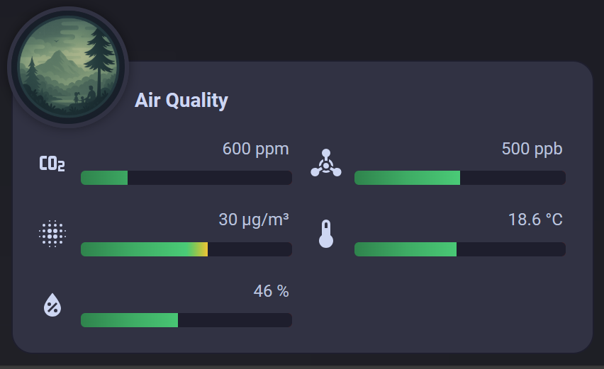
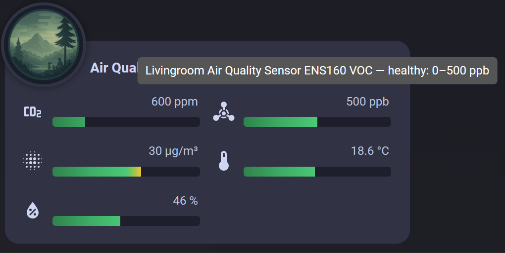
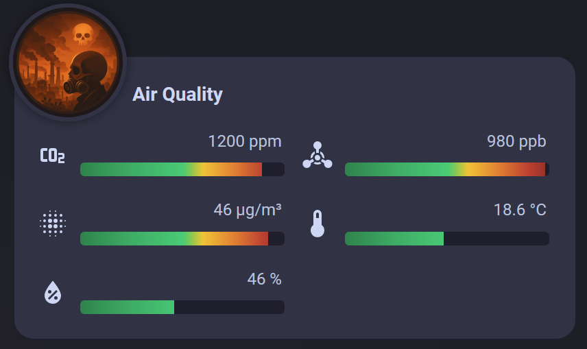

# AirQ Card


A custom Lovelace card for Home Assistant to display air quality data with healthy ranges.

## Installation (via HACS)

1. Go to HACS → Frontend → Menu (top right) → Custom Repositories
2. Add the URL of your own GitHub repository (replace the placeholders below).
   Type: Lovelace

   `https://github.com/<your-username>/<your-repository>`

3. Search for **AirQ Card** in HACS and install
4. Add the following resource to your dashboard:

```yaml
url: /hacsfiles/<repository-name>/airq-card.js
type: module
```

# Usage

```yaml
type: custom:airq-card
title: Luftqualität
entities:
  co2: sensor.your_co2
  voc: sensor.your_voc
  pm25: sensor.your_pm25
  temperature: sensor.your_temp
  humidity: sensor.your_humidity
  rating: sensor.your_rating
```

  - OR you may use the UI for picking the entities
  - You may leave the Absolute MAX and MIN empty for predefined ranges or change them to what you like.
  - Hoovering over the bars will reveal the name of the entity as well as the healthy range expected.
  - An Air Quality Rating entity is optional. The card recognizes unhealthy (ungesund), poor (schlecht), moderate (mäßig), good (gut), and excellent (ausgezeichnet) values, and displays the rating in German.
  - Rating images are no longer used by the card; there is no need to copy image files to Home Assistant.

  
  
  
  

  

## Herkunft und Lizenz

Diese angepasste Version basiert auf [Air Quality Card von RR](https://github.com/UrbanTechIO/air-quality-card).
Die ursprüngliche MIT-Lizenz und der Copyright-Hinweis aus dem Originalprojekt bleiben in [LICENSE](./LICENSE) erhalten.
Das Originalprojekt wurde vom [Flower Card von Olen](https://github.com/Olen/lovelace-flower-card) inspiriert.

  
